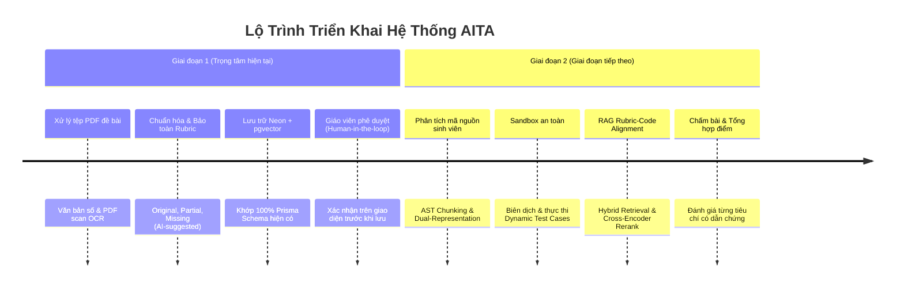
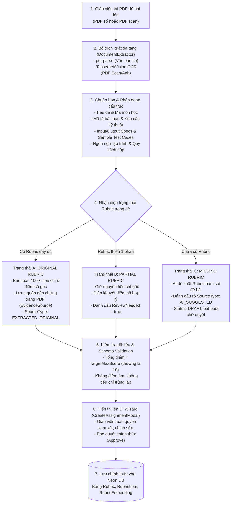
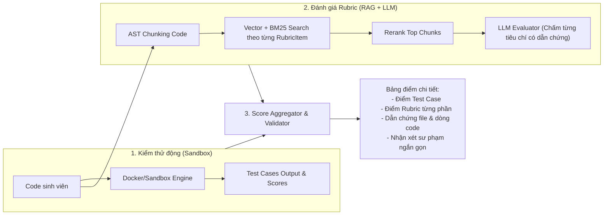

# ĐẶC TẢ KIẾN TRÚC HỆ THỐNG AITA: XỬ LÝ ĐỀ PDF, QUẢN LÝ RUBRIC & RAG CHẤM MÃ NGUỒN
*(AITA Architecture Specification: PDF Processing, Rubric Lifecycle & Code-Augmented Grading)*

---

## 1. Đánh Giá Hiện Trạng & Định Hướng Triển Khai

Dựa trên quá trình rà soát và đối chiếu với hệ sinh thái thực tế của dự án (`aita-backend`, `aita-fontend`, cơ sở dữ liệu Neon PostgreSQL và Prisma schema), hệ thống thống nhất định hướng triển khai như sau:

### 1.1. Những phần đã chuẩn xác với yêu cầu
| Nội dung trong kiến trúc | Đánh giá thực tế | Trạng thái tích hợp |
| :--- | :--- | :--- |
| **PostgreSQL + pgvector** | Hoàn toàn phù hợp với hạ tầng Neon PostgreSQL hiện tại, không phát sinh chi phí hay độ phức tạp khi vận hành thêm cụm Vector DB riêng biệt. | Đã có sẵn mô hình `RubricEmbedding` trong Prisma schema. |
| **Lưu tiêu chí Rubric, điểm tối đa, từ khóa kỹ thuật & embedding** | Đã được chuẩn hóa theo đúng cấu trúc `model Rubric`, `RubricItem`, `RubricEmbedding` hiện có trong schema. | Sẵn sàng mở rộng, bảo toàn 100% schema gốc. |
| **AST-based Code Chunking (theo hàm, lớp, khối logic)** | Khắc phục triệt để hiện tượng đứt gãy cú pháp so với cắt vụn theo dòng/ký tự. | Định hướng cốt lõi cho Giai đoạn 2. |
| **Tìm kiếm kết hợp (Hybrid Search: Dense Vector + BM25)** | Giúp tìm chính xác đoạn code vừa khớp ngữ nghĩa vừa khớp tên hàm/biến bắt buộc. | Định hướng cho Giai đoạn 2. |
| **Chấm từng tiêu chí Rubric độc lập (Item-by-Item)** | Ngăn chặn hiện tượng ảo giác (hallucination), kiểm soát chặt chẽ barem điểm và dễ giải trình. | Định hướng cho Giai đoạn 2. |
| **Dẫn chứng minh bạch theo File và Dòng code (Citation)** | Cần thiết để giáo viên và sinh viên kiểm tra chéo, giải quyết khiếu nại (Appeal). | Đã thiết kế cấu trúc JSON dẫn chứng. |
| **Kiểm định tổng điểm và cấu trúc kết quả** | Đảm bảo điểm số không bao giờ âm, không vượt quá `TotalPoints` và tuân thủ schema Zod. | Đã áp dụng bộ lọc validation. |

---

### 1.2. Phân kỳ 2 giai đoạn triển khai (Phased Strategy)
Để đảm bảo tính ổn định và dễ dàng cô lập lỗi (xác định lỗi do đọc PDF, do sinh rubric, do tìm kiếm hay do chấm code), dự án **phân chia rõ ràng thành 2 giai đoạn độc lập**:



---

## 2. Quy Trình Xử Lý Đề Bài PDF (Trọng Tâm Giai Đoạn 1)

Quy trình đọc, trích xuất và chuẩn hóa đề bài từ file PDF là mắt xích quan trọng nhất của hệ thống, quyết định độ chính xác của toàn bộ chu trình chấm điểm về sau.



### Chi tiết 7 bước xử lý đề thi PDF:
1. **Tiếp nhận file PDF**: Hỗ trợ định dạng PDF nhiều trang, bảo đảm thứ tự các phần từ bìa thi, nội dung câu hỏi đến barem điểm cuối trang.
2. **Trích xuất văn bản & OCR Fallback**:
   - Nếu PDF chứa text layer: Trích xuất nội dung số, chuẩn hóa Unicode tiếng Việt dựng sẵn.
   - Nếu PDF là dạng scan/ảnh chụp (text layer rỗng hoặc dưới 50 ký tự): Kích hoạt cờ cảnh báo OCR hoặc gọi engine OCR trích xuất văn bản, tránh việc hệ thống bị crash hoặc trả về dữ liệu rỗng.
3. **Phân tích cấu trúc ngữ nghĩa đề bài**:
   - Tên bài tập / Đề thi (`suggestedTitle`).
   - Mô tả bài toán nghiệp vụ (`description` dạng Markdown đầy đủ).
   - Ngôn ngữ lập trình yêu cầu (`detectedLanguage` - C, C++, Java, Python, SQL, C#).
   - Ràng buộc & Đặc tả đầu vào/đầu ra (`inputSpecification`, `outputSpecification`).
   - Bộ Test Case ví dụ (`testCases` từ bảng hoặc văn bản Input/Output).
   - Quy chuẩn nộp bài (`submissionFormat`: file đơn lẻ hay file nén zip).
4. **Phân loại 3 trạng thái Rubric (Rubric Life-cycle)**:
   - **Trạng thái A (Có sẵn Rubric gốc)**: Bóc tách chính xác từng mục điểm (ví dụ: `Đọc dữ liệu: 1đ`, `Hàm tính toán: 2.5đ`). Giữ nguyên 100% tiêu chí của giảng viên, trích dẫn số trang/vị trí tìm thấy vào `EvidenceSource`.
   - **Trạng thái B (Rubric thiếu một phần)**: Có tiêu chí nhưng thiếu điểm số, hoặc tổng điểm chưa đủ 10. Hệ thống bảo toàn nội dung tiêu chí gốc, hỗ trợ chuẩn hóa tỷ lệ điểm và bật cờ `ReviewNeeded = true`.
   - **Trạng thái C (Hoàn toàn chưa có Rubric)**: AI tự động phân tích độ khó của đề để đề xuất bộ Rubric hợp lý. **Tuyệt đối không được tự ý áp dụng ngay**, mà phải gắn nhãn `SourceType: "AI_SUGGESTED"`, trạng thái `Status: "DRAFT"` và yêu cầu giáo viên duyệt.
5. **Kiểm tra dữ liệu (Validation & Integrity Check)**:
   - Tính toán hash tài liệu (`DocumentHash: SHA-256`) để tránh phân tích lại tài liệu trùng lặp.
   - Kiểm tra tổng điểm các tiêu chí khớp với `TotalPoints` (thang 10 hoặc thang do giảng viên chỉ định).
6. **Xác nhận qua giao diện (Human-in-the-loop Review UI)**:
   - Đưa dữ liệu trích xuất vào form tạo bài tập trên `aita-fontend`.
   - Giảng viên trực tiếp kiểm tra, tinh chỉnh tiêu chí, thêm/bớt test case hoặc chỉnh sửa mô tả trước khi bấm "Xuất bản".
7. **Lưu trữ & Vector hóa**:
   - Lưu Rubric đã được giáo viên duyệt vào Neon PostgreSQL.
   - Sinh vector nhúng (Embedding) cho từng tiêu chí để sẵn sàng phục vụ tìm kiếm ở Giai đoạn 2.

---

## 3. Đối Chiếu & Đồng Bộ Schema Cơ Sở Dữ Liệu Hiện Có (Prisma & Neon)

Kiến trúc **bám sát 100% Schema hiện có** trong `prisma/schema.prisma` của dự án, đảm bảo tính tương thích tuyệt đối mà không phá vỡ mô hình dữ liệu hiện tại:

### 3.1. Bảng `Rubric` (Đã có trong schema)
```prisma
model Rubric {
  Id           String            @id @default(uuid())
  Title        String
  Description  String?           @db.Text
  ExamId       String?
  SubjectCode  String?
  Language     String?
  Category     String?           @default("standard")
  SourceType   String            @default("EXTRACTED_ORIGINAL") // EXTRACTED_ORIGINAL | AI_SUGGESTED | HYBRID
  Status       String            @default("DRAFT")              // DRAFT | PENDING_REVIEW | APPROVED | ARCHIVED
  Version      Int               @default(1)
  TotalPoints  Decimal           @default(10) @db.Decimal(18, 2)
  RawEvidence  String?           @db.Text                       // Lưu đoạn trích từ đề bài chứng minh rubric
  DocumentHash String?                                          // SHA-256 của file PDF đề
  DocumentName String?
  DocumentUrl  String?
  CreatedBy    String?
  ApprovedBy   String?                                          // ID giáo viên phê duyệt
  ApprovedAt   DateTime?
  MetadataJson String?           @db.Text
  CreatedAt    DateTime          @default(now())
  UpdatedAt    DateTime          @updatedAt
  Criteria     RubricItem[]
  Embeddings   RubricEmbedding[]
  Exam         Exam?             @relation(fields: [ExamId], references: [Id], onDelete: SetNull)
  UserCreator  User?             @relation("Rubric_CreatedByToUser", fields: [CreatedBy], references: [Id], onDelete: SetNull)
  UserApprover User?             @relation("Rubric_ApprovedByToUser", fields: [ApprovedBy], references: [Id], onDelete: SetNull)

  @@index([ExamId])
  @@index([SubjectCode])
  @@index([Language])
  @@index([Status])
  @@index([DocumentHash])
}
```

### 3.2. Bảng `RubricItem` (Đã có trong schema)
```prisma
model RubricItem {
  Id             String            @id @default(uuid())
  RubricId       String
  Name           String
  Description    String            @db.Text
  MaxPoints      Decimal           @default(2) @db.Decimal(18, 2)
  Weight         Decimal?          @default(1) @db.Decimal(18, 2)
  Method         String            @default("ai_assessment")      // ai_assessment | testcase_pass | code_metrics | manual
  PassCondition  String?           @db.Text
  FailCondition  String?           @db.Text
  LevelsJson     String?           @db.Text
  EvidenceSource String?           @db.Text                       // Vị trí trang, trích dẫn đoạn barem gốc trong PDF
  SortOrder      Int               @default(1)
  ReviewNeeded   Boolean           @default(false)
  CreatedAt      DateTime          @default(now())
  UpdatedAt      DateTime          @updatedAt
  Rubric         Rubric            @relation(fields: [RubricId], references: [Id], onDelete: Cascade)
  Embeddings     RubricEmbedding[]

  @@index([RubricId])
  @@index([SortOrder])
}
```

### 3.3. Bảng `RubricEmbedding` (Vector Collection)
```prisma
model RubricEmbedding {
  Id           String                      @id @default(uuid())
  RubricId     String?
  RubricItemId String?
  ExamId       String?
  ContentType  String                      // "CRITERION_FULL" | "TECHNICAL_KEYWORDS" | "CODE_REQUIREMENTS"
  Content      String                      @db.Text
  Embedding    Unsupported("vector(768)")? // Tương thích với text-embedding-004 hoặc linh hoạt theo model
  ModelName    String                      @default("text-embedding-004")
  Dimensions   Int                         @default(768)
  Language     String?
  SubjectCode  String?
  Category     String?
  MetadataJson String?                     @db.Text
  CreatedAt    DateTime                    @default(now())
  Rubric       Rubric?                     @relation(fields: [RubricId], references: [Id], onDelete: Cascade)
  RubricItem   RubricItem?                 @relation(fields: [RubricItemId], references: [Id], onDelete: Cascade)

  @@index([RubricId])
  @@index([RubricItemId])
  @@index([ExamId])
}
```

> [!NOTE]
> **Về cấu hình Index và Kích thước Vector**:
> 1. Số chiều vector `Dimensions` phụ thuộc trực tiếp vào embedding model được sử dụng (ví dụ: Google `text-embedding-004` là 768 chiều; OpenAI `text-embedding-3-small` là 1536 chiều; BGE-M3 là 1024 chiều). Dự án xác định rõ model trước khi khởi tạo cột vector.
> 2. Về chỉ mục tìm kiếm (Indexing): Trong giai đoạn đầu khi số lượng tiêu chí rubric ở quy mô hàng nghìn vector, tìm kiếm **Exact Flat Search (Cosine Distance)** cho tốc độ mili-giây và độ chính xác tuyệt đối 100%. Khi quy mô mở rộng, chỉ mục **HNSW** (`vector_cosine_ops`) sẽ được ưu tiên hơn `IVFFlat` vì HNSW không yêu cầu huấn luyện lại danh sách cụm khi thêm dữ liệu mới.

---

## 4. Đặc Tả Giai Đoạn 2: RAG Cho Mã Nguồn & Chấm Bài Tự Động

Khi Giai đoạn 1 đã ổn định (đề bài và rubric được chuẩn hóa vào DB), Giai đoạn 2 sẽ triển khai cơ chế đối chiếu mã nguồn của sinh viên:

### 4.1. Bảng mở rộng cho mã nguồn: `SubmissionCodeChunk`
*(Dự kiến bổ sung vào Prisma Schema ở Giai đoạn 2)*:
```prisma
model SubmissionCodeChunk {
  Id             String                      @id @default(uuid())
  SubmissionId   String
  FilePath       String
  ChunkType      String                      // 'function' | 'class' | 'module_scope'
  IdentifierName String?                     // Tên hàm/lớp: 'sum_odd_numbers', 'Student'
  StartLine      Int
  EndLine        Int
  RawCode        String                      @db.Text
  CodeSummary    String?                     @db.Text // Tóm tắt ngữ nghĩa để tìm kiếm với rubric text
  Embedding      Unsupported("vector(768)")?
  CreatedAt      DateTime                    @default(now())

  @@index([SubmissionId])
  @@index([IdentifierName])
}
```

### 4.2. Vai trò của Sandbox an toàn so với RAG
> [!IMPORTANT]
> **RAG không thay thế việc thực thi chương trình**:
> - **Execution Sandbox (Docker / Isolate)**: Đảm nhận chạy các Test Case thực tế (Input/Output), đo thời gian chạy (Execution Time), lượng bộ nhớ tiêu thụ (Memory Limit) và bắt các lỗi Runtime Error / Time Limit Exceeded.
> - **RAG & LLM Analysis**: Đảm nhận đánh giá tĩnh (Static Evaluation) theo các tiêu chí rubric định tính: chuẩn phong cách code (PEP8/Clean Code), cấu trúc thuật toán, xử lý ngoại lệ, thiết kế hướng đối tượng hoặc các ràng buộc không thể kiểm tra bằng test case đen.

### 4.3. Quy trình chấm điểm phối hợp (Hybrid Grading Flow)


---

## 5. Nguyên Tắc Cốt Lõi: Đảm Bảo Tính Minh Bạch & Khách Quan

1. **Không tuyên bố "chấm đúng 100% chỉ nhờ RAG"**: Hệ thống là công cụ trợ giảng (AI Teaching Assistant - AITA). Kết quả chấm bài luôn đi kèm độ tin cậy (`confidence`), trạng thái vượt qua (`status`) và trích dẫn bằng chứng cụ thể. Giảng viên luôn có quyền can thiệp, điều chỉnh điểm số và ghi đè (`SubmissionOverride`).
2. **Bảo toàn dữ liệu gốc**: Dù đề thi có rubric hay không, đề gốc tải lên luôn được lưu trữ nguyên trạng. Bất kỳ suy luận nào của AI đều phải được đánh dấu rõ ràng (`AI_SUGGESTED`, `ReviewNeeded = true`).
3. **Phản hồi sư phạm ngắn gọn, có thể kiểm chứng**: LLM được chỉ thị cung cấp lời giải thích cô đọng (2-3 câu), chỉ rõ lý do trừ điểm và số dòng code vi phạm, không xuất các đoạn suy luận nội bộ dài dòng gây nhiễu cho người học.

---

## 6. Kế Hoạch Hành Động Ngay (Next Action Items)

1. **Ưu tiên 1 (Giai đoạn 1 - Hiện tại)**:
   - Tối ưu hóa bộ bóc tách `DocumentExtractorService` để nhận diện văn bản từ PDF nhiều trang và cảnh báo PDF dạng scan.
   - Hoàn thiện module nhận diện 3 trạng thái Rubric: Giữ nguyên barem gốc khi có sẵn, hỗ trợ AI đề xuất khi chưa có và yêu cầu giáo viên duyệt.
   - Đồng bộ hóa dữ liệu với bảng `Rubric`, `RubricItem`, `RubricEmbedding` trong cơ sở dữ liệu Neon.
2. **Ưu tiên 2 (Giai đoạn 2 - Kế tiếp)**:
   - Nghiên cứu thư viện phân tích cú pháp AST (`web-tree-sitter`) cho mã nguồn sinh viên.
   - Thử nghiệm mô hình embedding phù hợp và thiết lập chỉ mục HNSW trên Neon `pgvector`.
   - Kết nối kết quả chấm động từ Sandbox với bộ đánh giá Rubric RAG.
